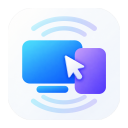
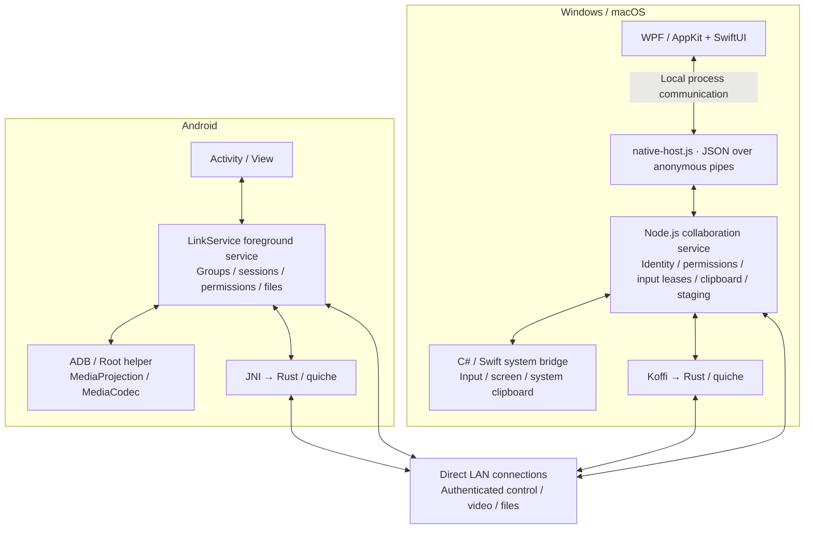

<p align="center">
  
</p>

<h1 align="center">LanLink</h1>

<p align="center"><strong>One keyboard and mouse. Your computers and phone, connected.</strong></p>
<p align="center">Cross-screen input · Remote desktop · Shared clipboard · File transfers<br>Windows · macOS · Android</p>
<p align="center"><a href="README.md">简体中文</a> · <strong>English</strong></p>
<p align="center"><a href="#quick-start">Get started</a> · <a href="#build">Build from source</a> · <a href="#architecture">Architecture</a> · <a href="#directory">Code map</a> · <a href="CHANGELOG.md">Changelog</a></p>

LanLink brings the computers and Android phones on your local network into one workspace. Move your mouse to a screen edge to continue on another device, open your phone's screen on your computer, or use your phone as a computer trackpad. Copy text and share files without constantly switching devices.

No account is required, and everyday collaboration works without cloud services or internet access. Devices join a group through a temporary numeric code or QR code, then exchange data over encrypted direct connections. Desktop clients use native windows and ship with their runtime.

> **Current version: 0.3.45 development preview.** This README describes the current working tree; it does not imply that every platform has passed physical-device acceptance testing. See [validation status](#validation) for the recorded scope. The repository does not yet include a project-wide license; see [licensing and third-party components](#license).

## Contents

- [Why LanLink](#features)
- [Platforms and capabilities](#platforms)
- [Get started](#quick-start)
- [Get the source and build](#build)
- [Architecture](#architecture)
- [Technology stack](#stack)
- [Repository and module guide](#directory)
- [Configuration and networking](#configuration)
- [Troubleshooting](#faq)
- [Current limitations](#limitations)
- [Development, testing, and contributions](#development)
- [Validation status](#validation)
- [Further reading](#documentation)
- [Licensing and third-party components](#license)

<a id="features"></a>
## Why LanLink

| What you want to do | How LanLink helps |
| --- | --- |
| **Share one keyboard and mouse** | Choose a Windows or Mac computer as the primary input device and arrange peers above, below, left, or right. Switch by dwelling at an edge or holding a shortcut at the edge; an emergency shortcut returns input locally. |
| **Operate your phone from a computer** | A native window displays the remote screen and remembers its layout per device. Android sessions include Back, Home, and Recent apps buttons. |
| **Operate your computer from a phone** | Remote video works with a trackpad, system keyboard, and function keys. Click, drag, scroll with two fingers, or zoom the view; fullscreen mode adds touch areas and gestures. |
| **Copy once and use it elsewhere** | Share text and supported file clipboard content within the group. Text history keeps up to 30 entries from the last 10 minutes. Automatic upload and download can be disabled separately, with manual sync available. |
| **Send files without disrupting your work** | Share files or folders from a computer, or send files through Android's system share menu. Received items go to a separate staging area for viewing, dragging out, or saving, without replacing the system clipboard. |
| **Keep working when the network slows down** | Input queues coalesce adjacent movements and discard stale motion, video adjusts its bitrate to latency and backlog, and file transfers leave bandwidth for active input and video. |
| **Use a cable or a second network** | A trusted USB debugging connection can assist computer–Android sessions. Computers can also use a second IP network interface. LanLink selects a path according to link conditions while the LAN connection stays online. |

**Highlights in 0.3.45:** isolated sessions across multiple devices, reuse of an already running Android helper by other group computers, adaptive input and video on poor connections, and macOS single-instance handling per data directory. See [CHANGELOG.md](CHANGELOG.md) for the full history.

<a id="platforms"></a>
## Platforms and capabilities

| Capability | Windows | macOS | Android |
| --- | --- | --- | --- |
| System requirements | Windows 10 / 11, x64; .NET Framework 4.8 and PowerShell 5.1 | macOS 14+; Apple Silicon builds have been validated | Android 10+ (API 29); targets API 35 |
| Native interface | WPF | AppKit / SwiftUI | Java Activity / View |
| Primary device for edge switching | Supported | Supported with system permissions | Not supported; remote video and trackpad control are available |
| Receive keyboard and mouse input | Supported, subject to system integrity levels | Requires Accessibility and relevant system permissions | Requires a ready ADB / Root helper |
| View a remote screen | Supported | Supported | Supported |
| Share the local screen | Supported | Requires Screen Recording permission | ADB / Root capture, or system-approved MediaProjection |
| Clipboard and file staging | Supported | Supported | Supported; background clipboard access requires the helper |
| Receive a remote shutdown request | Supported | Supported, subject to system restrictions | Not supported |

The macOS packaging script has `arm64` and `x64` paths. Recorded validation covers Apple Silicon; Intel Macs have not been validated. There is no native Linux or iOS client in this repository. “Supported” describes an existing implementation; see [validation status](#validation) for what has actually been tested.

<a id="quick-start"></a>
## Get started

### 1. Launch the clients

Use the [build instructions](#build) below to create a package for each platform. On Windows, extract the entire package and run `LanLink.exe`. On macOS, open `LanLink.app`. On Android, install the generated APK. Desktop packages include Node.js, so package users do not need to install it separately.

Closing the desktop's main window hides it and returns input locally while the application keeps running in the background. Use **Quit LanLink (退出 LanLink)** in the tray or application menu to exit completely.

Connect the devices to the same LAN with direct access to one another. Allow private-network access when Windows Firewall prompts you. Guest Wi-Fi or access-point isolation can prevent discovery and connections.

### 2. Pair your devices

Open **Add device (添加设备)** on one device. On the other, choose **Join another group (加入其他组)** and enter the **8-digit code**. Android can also scan the QR code or recognize it from an image.

- Codes refresh every 60 seconds and may contain leading zeros. Keep the inviting device's Add device window open.
- An invitation is consumed after a successful pairing and revoked when its window closes. The QR code does not contain the long-term group secret.
- Joining another group from a device whose current group has other members prompts you to dissolve that group first. Check which group you intend to change.

### 3. Prepare the permissions you need

**Starting with 0.3.45, joining a group grants default application-level trust to authenticated members.** Input, screen access, clipboard/files, and supported shutdown operations still depend on local feature switches, saved per-device restrictions, and system permissions. Disable individual capabilities in group-device permission management; reconnecting does not undo a revocation.

- **Windows:** enable the relevant application features. Secure desktops and elevated windows may restrict input.
- **macOS:** follow the prompts for Accessibility, Input Monitoring, and Screen Recording, then restart as instructed. Shutdown may also require Automation permission.
- **Receiving control on Android:** for initial setup through a computer, install Android SDK Platform-Tools on that computer first (ADB is not bundled). Enable USB debugging, trust the computer on the phone, and follow the desktop's **Android authorization (安卓授权)** guide to start the helper. A rooted phone can start its helper locally. Once ready, it can serve other computers in the group. Restarting the phone, terminating the helper, or revoking system authorization requires recovery. The ordinary MediaProjection capture path needs confirmation in Android's system dialog.

Using Android to control a computer, or only exchanging staged files, does not require enabling an ADB / Root helper on the phone. See the [Android control guide](docs/ANDROID-CONTROL.md) for details.

### 4. Choose how to work

- **Cross-screen input:** select a Windows / Mac computer as the primary input device, drag peers to its four edges, and choose a switching mode in settings. Edge dwell is configurable from 0–3000 ms, with a 100 ms default for new configurations.
- **Remote desktop:** choose **Desktop control (桌面控制)** in a device menu. The remote screen opens after readiness checks. Android offers a trackpad and keyboard for controlling a computer.
- **Clipboard:** copy text and paste on another device. The clipboard page also lets you inspect and copy history or trigger manual upload / download.
- **File sharing:** choose a recipient through a device menu, Windows file context menu, macOS Finder service, or Android system share menu, then save from the receiving staging area. Dragging files across a computer's screen edge first creates a pending offer; the recipient starts the transfer.

**Return input locally at any time with `Ctrl + Alt + F12`, or `Control + Option + F12` on macOS. Some keyboards also require `Fn`.** The receiving device can end a session locally; Android's foreground notification includes a stop action.

<a id="build"></a>
## Get the source and build

```sh
git clone https://github.com/lokey-t/lanlink.git
cd lanlink
npm ci --ignore-scripts
```

Desktop development requires **Node.js 22+**. Install dependencies from `package-lock.json`. Initial builds need internet access to obtain dependencies and tools; installed LAN features work offline. For an Android-only build, start with the Android steps below; desktop npm dependencies are not required.

**`npm start` opens an already built desktop package for the current version. It does not build the application.** Both desktop packaging scripts refuse to overwrite an existing output directory. Move any build you want to keep before rebuilding the same version.

<details>
<summary><strong>Windows · Build a portable ZIP</strong></summary>

Prepare the following on Windows x64:

- .NET Framework 4.8, Windows PowerShell 5.1, and Node.js 22+.
- Rust 1.88+ with the MSVC toolchain, Visual Studio C++ Build Tools / Windows SDK, CMake, NASM, and libclang. Use a terminal with the x64 MSVC environment loaded.
- An extracted official Node.js x64 distribution containing `node.exe` and `LICENSE` or `NODE-LICENSE`.
- Preferably, an FFmpeg distribution containing `bin/ffmpeg.exe` and `LICENSE.txt` for H.264 encoding and decoding.

Run from the repository root, replacing these example paths with your local directories:

```powershell
npm run icons
.\scripts\build-quic-windows.cmd
.\scripts\package-windows.ps1 -NodeRuntime "C:\tools\node-dist" -VideoRuntime "C:\tools\ffmpeg-dist"
npm start
```

Output: `dist/LanLink-0.3.45-windows-x64/` and a `.zip` with the same name. `-VideoRuntime` is optional, but without FFmpeg the desktop is limited to the JPEG fallback and cannot view phone screens that provide H.264 only. Build the native QUIC library before running the packaging script.

</details>

<details>
<summary><strong>macOS · Build the native app and ZIP</strong></summary>

Prepare macOS 14+, Xcode Command Line Tools, Node.js 22+, Rust 1.88+, CMake, and libclang. Extract an official Node.js distribution for your machine's architecture; it must contain `bin/node` and `LICENSE`.

```sh
LANLINK_NODE_DIST="/path/to/node-distribution" sh scripts/package-macos.sh
npm start
```

The script builds the Swift UI, system bridge, and Rust QUIC library. By default, it also builds and bundles FFmpeg from a pinned source release. Set `LANLINK_FFMPEG_DIST` to use an existing video runtime directory containing `bin/ffmpeg` and `LICENSE.txt`.

Apple Silicon output: `dist/LanLink-0.3.45-macos-arm64/LanLink.app` and `dist/LanLink-0.3.45-macos-arm64.zip`. The Intel path uses `macos-x64` and still needs validation. The current script uses ad-hoc signing, without Apple Developer signing or notarization.

</details>

<details>
<summary><strong>Android · Build a debug APK</strong></summary>

Open `android/` in Android Studio, install Android SDK 35, and use JDK 17 with the included Gradle 8.11.1 Wrapper. Configure the SDK location through Studio or your local `android/local.properties`; do not commit machine-specific paths.

```sh
cd android
./gradlew :app:assembleDebug
```

On Windows, use `gradlew.bat :app:assembleDebug`. Output: `android/app/build/outputs/apk/debug/app-debug.apk`, relative to the repository root. This creates a debug testing package, not a production-signed release.

To include native QUIC, first prepare Rust 1.88+, the Android targets, NDK r27+, CMake, Ninja, and libclang. Build each required ABI from the repository root, then rebuild the APK:

```sh
rustup target add aarch64-linux-android x86_64-linux-android
export ANDROID_NDK_HOME="/path/to/android-ndk"
sh scripts/build-quic-android.sh arm64-v8a
sh scripts/build-quic-android.sh x86_64
```

On Windows, use `scripts/build-quic-android.cmd` for the native library. Libraries are staged under `android/app/src/main/jniLibs/`; an ABI without a usable QUIC library uses compatible fallback transports. See the [Android Studio guide](docs/ANDROID-STUDIO.md) for IDE setup, device connections, and debugging.

</details>

<a id="architecture"></a>
## Architecture

LanLink separates **native interfaces, collaboration services, system capabilities, and network transports**. Desktop UI code handles interaction, while the shared Node.js service owns groups and sessions. C# / Swift bridges perform system input and screen operations. Android's native foreground service handles the equivalent networking and session responsibilities.



### From discovery to collaboration

1. **Identity and pairing:** each device has a UUID and an RSA-2048 identity key pair. Temporary invitations exchange group credentials through SRP-6a. Private keys remain local; member management supports removal, key rotation, and group dissolution.
2. **Discovery and authentication:** IPv4 UDP broadcasts find group members, and the primary TCP connection authenticates peers and derives session keys. Manual connections also require authentication. Peers connect directly without a central server.
3. **Capabilities and permissions:** devices exchange platform and feature capabilities, then check group identity, local feature switches, per-device restrictions, and system readiness. An input lease allows only one input owner for a target at a time.
4. **Transport negotiation:** authenticated connections exchange QUIC tickets, certificate fingerprints, and video / file session information. Transport selection depends on both peers' capabilities and the chosen link.
5. **Cleanup and recovery:** heartbeats, leases, and a native watchdog release held input after connection loss. Sessions are isolated by device identity, so a late close message cannot terminate a new session with another target.

### Which data uses which transport

| Data | Preferred or dedicated path | Fallback and purpose |
| --- | --- | --- |
| Discovery, initial pairing, and base authentication | UDP discovery / invitation probes, then authenticated TCP | Pairing and authentication work before QUIC is negotiated |
| Mouse movement | QUIC Datagram | Sequence numbers, cumulative movement, and short-term recovery; compatible paths retain movement coalescing |
| Clicks, keys, permissions, and clipboard notifications | QUIC reliable streams or the encrypted control connection | Preserve ordering boundaries without injecting the same input over multiple links |
| H.264 / JPEG frames | QUIC Datagram, with WebRTC DataChannel and separate encrypted TCP alternatives | Request a keyframe when the reference chain is lost; a selected USB-assisted path uses TCP |
| File content | QUIC reliable streams or separate AES-GCM binary TCP | SHA-256 chunk checks and bounded retries within a task; legacy chunk protocol remains available |

**H.264 / JPEG describe frame encoding; QUIC / WebRTC / TCP describe transport.** WebRTC carries existing encoded frames over DTLS/SCTP DataChannels and uses no public STUN / TURN service. USB or a second network is an alternative connection path, not a video codec; its bandwidth is not added to Wi-Fi bandwidth.

### Trust and encryption boundaries

The TCP control protocol uses HMAC-SHA256 authentication, HKDF directional keys, and AES-256-GCM. QUIC uses quiche / BoringSSL, with short-lived single-use tickets and certificate fingerprints bound to an authenticated connection. Switching transports does not bypass application permissions.

The current custom TCP pre-shared-key protocol **does not provide forward secrecy and has not undergone an independent security audit**. Share pairing codes only with devices you trust. Authenticated members receive default application-level trust while system permissions and saved restrictions remain effective. See the [protocol architecture](docs/ARCHITECTURE.md) and [group management guide](docs/GROUPS.md) for message formats and member revocation.

<a id="stack"></a>
## Technology stack

| Layer | Technologies | Role in LanLink |
| --- | --- | --- |
| Desktop collaboration core | JavaScript ES modules, Node.js 22+ | Connections, identity, pairing, input leases, synchronization, and file tasks; uses Node's built-in networking, cryptography, and test modules |
| Windows UI and integration | C#, WPF, .NET Framework 4.8, Win32, PowerShell | Native windows and tray, input capture / injection, clipboard, file drag-and-drop, startup integration |
| macOS UI and integration | Swift, AppKit, SwiftUI, CoreGraphics, ScreenCaptureKit, ServiceManagement | Native windows, input events, screen access, Finder sharing service, login items |
| Android client | Java 17, Android SDK 35, Gradle 8.11.1, AGP 8.9.2 | Activity / View UI, foreground service, system sharing, permissions, and lifecycle |
| Native QUIC | Rust 2021, quiche 0.30.0, BoringSSL through boring 5.2.0 | Shared reliable-stream and Datagram implementation across all three platforms; dependencies locked by Cargo.lock |
| Native library bindings | Koffi 2.15.1, JNI | Connect Node.js and Android to the shared Rust core |
| Video encoding and decoding | FFmpeg, VideoToolbox, Android MediaCodec | H.264 processing and JPEG fallback; Windows selects from available encoders |
| WebRTC fallback transport | werift 0.24.4, Android WebRTC SDK 150.7871.01 | LAN video transport over DataChannels |
| QR codes | qrcode-generator 2.0.4, ZXing core 3.5.3 | Desktop pairing-code generation and Android QR recognition |
| Standalone website | HTML, CSS, JavaScript, SVG | Static site without a frontend framework, built independently of the desktop clients |

The desktop UI does not depend on Electron or WebView. `web/` is a historical development console; `website/` is the separate project website. Neither renders the native desktop interface.

<a id="directory"></a>
## Repository and module guide

```text
lanlink/
├── src/                         # Cross-platform desktop collaboration service
├── desktop/
│   ├── windows/                 # WPF windows, device layout, remote control, file drag-and-drop
│   └── macos/                   # AppKit / SwiftUI, remote control, sharing, single-instance handling
├── native/
│   ├── windows/                 # C# / PowerShell system bridge
│   ├── macos/                   # Swift system bridge and build script
│   └── quic/                    # Rust QUIC core, Cargo.toml / Cargo.lock
├── android/
│   ├── app/src/main/java/com/lanlink/app/  # Android application and collaboration service
│   ├── app/src/main/res/         # Icons, themes, strings, and other resources
│   ├── app/src/main/assets/      # Third-party notices distributed with the APK
│   ├── app/src/main/jniLibs/     # Native QUIC build output, by ABI
│   ├── app/src/androidTest/      # Pairing, permission, input, video, and device probes
│   ├── app/src/debug/            # Input probes included only in debug builds
│   └── gradle/                  # Gradle Wrapper; build configuration sits alongside it
├── web/                         # Development-only HTTP console
├── website/                     # Standalone website, translations, tests, and static build
├── assets/                      # App icons, source artwork, and icon concepts
├── vendor/                      # QR component, third-party notices, video build records
├── tests/                       # Node unit / integration tests and Java / Swift probes
├── scripts/                     # Builds, packaging, syntax checks, and focused validation
├── docs/                        # Protocols, usage guides, acceptance and validation reports
├── runtime/                     # Local runtime libraries, generated during builds
├── dist/                        # Generated apps, portable packages, and ZIPs
├── .tools/                      # Local tools, caches, and validation output; not committed
├── package.json / package-lock.json  # Desktop version, commands, and locked Node dependencies
├── start-windows.cmd / start-macos.command  # Platform launch scripts
├── README.md                    # Chinese project overview
├── README.en.md                 # English project overview
├── CHANGELOG.md                 # Preserved release history
└── THIRD_PARTY_NOTICES.md        # Third-party components and distribution notes
```

Generated directories may not exist before the first build. Start with these files when exploring or changing a feature:

| Area | Main entry points |
| --- | --- |
| Desktop entry and action dispatch | `src/native-host.js`, `src/actions.js`; `src/service.js` coordinates the collaboration lifecycle |
| Identity, groups, and encryption | `src/identity.js`, `group.js`, `pairing.js`, `pairing-crypto.js`, `wire.js` |
| Discovery and link selection | `src/discovery.js`, `links.js`; `adb.js` / `adb-guide.js` handle Android helpers and setup guidance |
| Permission checks and control direction | `src/consent.js`, `permissions.js`, `access.js`, plus lease management in `service.js` |
| Cross-screen input | `src/master.js`, `edge.js`, `input-queue.js`, `quic-motion.js` |
| Video and adaptation | `src/video.js`, `video-wire.js`, `video-codec.js`, `adaptive-video.js`, `frame-rate.js` |
| QUIC / WebRTC integration | `src/quic.js`, `quic-native.js`, `rtc-video.js`, and `native/quic/src/lib.rs` |
| Clipboard, file transfer, and staging | `src/clipboard-sync.js`, `bulk.js`, `staging.js` |
| System operations | `src/native.js` calls `native/windows/Bridge.cs` or `native/macos/Bridge.swift` |
| Desktop UI | `desktop/windows/Main.cs` / `Remote.cs`; `desktop/macos/LanLink.swift` / `Remote.swift` |
| Android sessions and UI | `MainActivity.java`, `LinkService.java`, `TouchpadView.java`, `RemoteFullscreen.java` |
| Android input and video | `ShellAgent.java`, `ShellChannel.java`, `VirtualHid.java`, `VideoHost.java`, `SharedVideoSource.java`, `VideoPlayer.java` |
| Android files and transports | `StagingFiles.java`, `GroupClipboard.java`, `BulkTransfer.java`, `QuicManager.java`, `RtcVideo.java` |

JavaScript filenames with an omitted prefix in the same row are under `src/`. Android filenames are under `android/app/src/main/java/com/lanlink/app/`.

<a id="configuration"></a>
## Configuration and networking

Desktop clients store identity, settings, and received data in **`.lanlink/`** under the user's home directory by default. Android uses private application storage. Use desktop `--data` to select a separate data directory, for example:

```powershell
.\LanLink.exe --data "D:\LanLinkData"
```

Development services also accept `--port`, `--no-discovery`, and `--simulate`. The last option uses simulated system capabilities and cannot validate real input or capture behavior. Text clipboard history stays in memory and can be replenished from online peers after a restart; staging manifests and completed received files are persisted.

| Purpose | Default port / behavior |
| --- | --- |
| Base encrypted control connection | TCP `45831` |
| Group discovery | UDP `45832`, IPv4 broadcast |
| Temporary pairing discovery | UDP `45833`, followed by a temporary TCP port |
| Member updates and group recovery | UDP `45834` |
| QUIC / WebRTC media | Dynamic UDP ports negotiated over an authenticated connection |
| Separate TCP video / files | Dynamic TCP ports negotiated over an authenticated connection |
| Development HTTP console | Enabled only by `npm run dev:http`; defaults to `127.0.0.1:45830` |

**Allowing only the fixed ports does not cover every transport.** Prefer application-level firewall rules on a private LAN, and check guest-network isolation, AP isolation, and broadcast restrictions. Normal native desktop startup does not expose an HTTP console.

<a id="faq"></a>
## Troubleshooting

| Problem | What to check |
| --- | --- |
| `npm start` says to build first | Run the platform packaging script. The launcher looks for a `dist/` package matching the version in `package.json`. |
| Devices are missing or pairing fails | Keep both clients online and the invitation window open, and use the current code. Check the firewall, broadcasts, and network isolation. A known address can be connected manually, but authentication still applies. |
| Android is no longer controllable after reboot | Reconnect a trusted debugging computer to recover the helper, or restore the Root helper on a rooted phone. Saved desktop records do not replace Android's current system authorization. |
| Does another computer need USB if the helper is already ready? | A group computer can reuse the running helper over its encrypted connection. Establishing that computer's own USB debugging trust still requires confirmation on the phone. |
| Android's clipboard stops updating in the background | Check the ADB / Root helper. If it is unavailable, bring LanLink to the foreground to sync. |
| Control connects but no video appears | Check screen permission, capture readiness, FFmpeg / codec availability, and media ports separately. Input access does not imply screen access. |
| Sent files do not appear in the recipient's clipboard | Send files uses the separate staging area. Open the desktop staging page or Android Control Center to view and save them. |
| macOS packaging says the build already exists | The script prevents overwriting its output directory. Preserve or move the old build before retrying. |

<a id="limitations"></a>
## Current limitations

- **Networking and platforms:** designed for directly reachable IPv4 LAN peers, with no public relay, internet NAT traversal, or cloud account. USB assistance still requires the LAN connection. An ordinary cable between computers is usable only if the operating system exposes an IP network interface.
- **Control topology:** edge layouts use four directions around a primary device. Desktop operation uses the primary display, without arbitrary multi-monitor stitching. A target accepts one input owner at a time; a device cannot control a third device while it is being controlled or viewed.
- **Video:** H.264 / JPEG and adaptive bitrate are implemented. Audio, HDR, FEC, and a fully zero-copy pipeline are not. LanLink does not implement the Moonlight / Sunshine protocol or promise fixed frame rates or gaming-grade latency.
- **Files:** staging supports up to 100 top-level items per share, 2 GiB per item, 1,000 files and directories per folder item, and 200 received items. Directory structure and empty folders are preserved; symbolic links and special files are unsupported.
- **Transfer recovery:** bounded retries can resume from verified, written offsets within the current task. Persistent resume across application restarts is not implemented. Saving successfully removes the received staging item while preserving the sender's original files.
- **Clipboard:** text and files are supported; HTML rich text, bitmap clipboard data, and cut/delete semantics are not. Images can be shared as files. The destination application must support the relevant paste format.
- **System permissions:** UAC secure desktops, lock screens, protected content, and vendor debugging restrictions may block input or capture. LanLink cannot silently grant system permissions. Offline devices also need to encounter a member holding an update before learning about removal or group dissolution.

<a id="development"></a>
## Development, testing, and contributions

Run the standard checks from the repository root:

```sh
npm run check
npm test
```

`check` validates JavaScript syntax. `npm test` covers identity, protocols, permissions, control conflicts, transport, staging, and recovery. Some integration tests need loopback listeners; native-library and platform-specific tests may be skipped depending on the environment.

On Windows / macOS, you can also check whether the native bridge is available. On macOS, build the package first or run `sh native/macos/build.sh` to build the bridge separately:

```sh
node scripts/native-smoke.js
```

This script loads the system bridge, reads its capabilities, and resets the input mode to local. It does not send keyboard or mouse events, capture the screen, read the clipboard, or shut down a device.

The macOS UI test requires a logged-in graphical session and can be enabled explicitly:

```sh
LANLINK_MAC_UI_TESTS=1 node --test tests/mac-remote.test.js
```

To inspect the collaboration service, start the local HTTP development console with simulated system capabilities and open the full URL printed in the terminal:

```sh
npm run dev:http -- --simulate --data .tools/dev-profile
```

Preview, test, and build the standalone website:

```sh
npm --prefix website run dev
npm --prefix website test
npm --prefix website run build
```

The preview runs at `http://127.0.0.1:4173`; output goes to `website/dist/`. The website currently includes Simplified Chinese, Traditional Chinese, English, Japanese, German, and French. This is separate from language support in the native clients. See the [website source guide](https://github.com/lokey-t/lanlink/blob/main/website/README.md).

When opening an [issue](https://github.com/lokey-t/lanlink/issues), include both client versions, operating systems, device roles, the network / USB path, reproduction steps, expected and actual behavior, and relevant redacted logs. Do not attach group secrets, private keys, pairing codes, or a full configuration directory.

Suggestions and [pull requests](https://github.com/lokey-t/lanlink/pulls) are welcome. Keep changes focused: explain compatibility fallbacks and permission implications for protocol changes, record actual test environments for platform features, and keep both READMEs in sync for documentation changes. Confirm the project licensing terms below before reusing or redistributing code.

<a id="validation"></a>
## Validation status

These are **results already recorded in the repository**, not a claim that all three platforms were retested while writing this README.

| Report | Covered | Does not establish |
| --- | --- | --- |
| [2026-10-09 · 0.3.45 multi-device and poor-network changes](docs/MULTI-DEVICE-VALIDATION-2026-10-09.md) | 196 regression cases: 195 passed, 0 failed, 1 Mac UI test skipped by default and passed when enabled separately; Mac app / bridge builds, bundled runtime startup and shutdown; multi-service and adaptation tests | Four physical devices working together; a fresh Windows WPF build for these changes; weak-network or long-running physical-phone testing |
| [2026-10-08 · Mac / Android remote control](docs/REMOTE-CONTROL-VALIDATION-2026-10-08.md) | Real Mac modules with an Android 14 emulator: input, H.264, reverse-direction video, and auxiliary-link fallback | Every vendor ROM or long-running physical mouse use; the focused script's exit cleanup did not pass |
| [2026-10-07 · initial macOS build](docs/MACOS-VALIDATION-2026-10-07.md) | Apple Silicon native build, packaging, signature verification, and basic UI | Intel Macs, Apple notarization, or full three-platform acceptance |

See [VALIDATION.md](docs/VALIDATION.md) for historical Windows / Android results and [ACCEPTANCE.md](docs/ACCEPTANCE.md) for physical-device checks. Older documents retain their original context. For current group trust defaults, available transports, and build behavior, use this README, the current source, and newer validation reports.

<a id="documentation"></a>
## Further reading

The detailed guides and historical release notes are currently primarily in Chinese. The Chinese project overview is [README.md](README.md).

| Document | Contents |
| --- | --- |
| [Architecture and protocol](docs/ARCHITECTURE.md) | Authentication, discovery, message formats, permissions, and security boundaries |
| [Groups and membership](docs/GROUPS.md) | Member removal, key rotation, dissolution, and offline-member recovery |
| [QUIC transport](docs/QUIC.md) | Reliable streams, Datagrams, ticket authentication, and fallback |
| [Video streaming](docs/STREAMING.md) | Codecs, keyframe recovery, WebRTC / TCP, and adaptation |
| [Cable and network cooperation](docs/DUAL-LINK.md) | USB / second IP path selection, recovery, and limitations |
| [File staging](docs/FILE-STAGING.md) | System sharing, cross-screen dragging, storage, and transfer lifecycle |
| [Android control](docs/ANDROID-CONTROL.md) | ADB / Root helpers, input, and platform permissions |
| [Android Studio setup](docs/ANDROID-STUDIO.md) | SDK setup, building, installation, and device debugging |
| [Acceptance checklist](docs/ACCEPTANCE.md) | Physical-device feature and permission checks |
| [Changelog](CHANGELOG.md) | Historical feature changes preserved from the original README |

<a id="license"></a>
## Licensing and third-party components

**There is currently no root `LICENSE` covering the entire project.** The `license = "MIT"` declaration in `native/quic/Cargo.toml` applies to that Rust crate's metadata; it does not establish licensing for the whole repository. Third-party licenses likewise do not license LanLink itself. Confirm the applicable terms with the maintainer before reusing, modifying, or redistributing project code.

LanLink uses quiche / BoringSSL, Koffi, werift, Android WebRTC, FFmpeg, qrcode-generator, and ZXing. See [THIRD_PARTY_NOTICES.md](THIRD_PARTY_NOTICES.md) for component sources, licenses, and distribution requirements. Preserve the corresponding license notices and source / build information when packaging.
