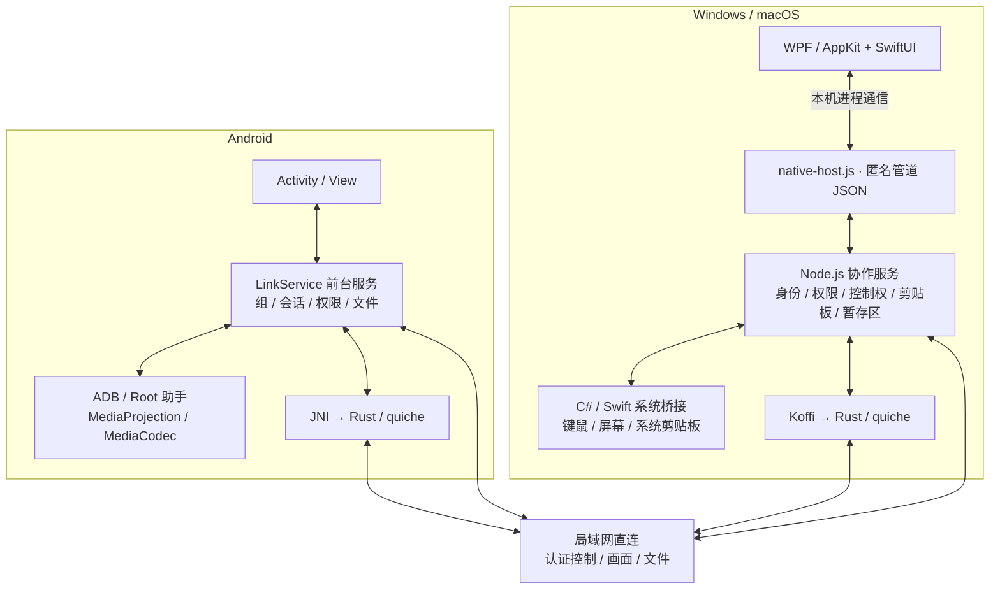

<p align="center">
  
</p>

<h1 align="center">LanLink</h1>

<p align="center"><strong>一套键鼠，连接你的电脑与手机。</strong></p>
<p align="center">跨屏操作 · 远程画面 · 共享剪贴板 · 文件传输<br>Windows · macOS · Android</p>
<p align="center"><strong>简体中文</strong> · <a href="README.en.md">English</a></p>
<p align="center"><a href="#quick-start">开始使用</a> · <a href="#build">源码构建</a> · <a href="#architecture">架构设计</a> · <a href="#directory">源码导览</a> · <a href="CHANGELOG.md">更新记录</a></p>

LanLink 让同一局域网里的电脑和 Android 手机一起工作：把鼠标移到屏幕边缘，继续操作另一台设备；在电脑上打开手机画面，或把手机变成电脑的触控板；复制文字、分享文件，减少设备之间的来回切换。

无需注册账号，日常协作不依赖云端服务或互联网。设备通过临时数字码或二维码加入同一组，再以加密直连传输数据。桌面采用原生窗口，运行环境随软件包提供。

> **当前版本：0.91.0。** 本文描述当前工作树的实现，不等同于所有平台均已完成实机验收。构建与测试范围见[验证状态](#validation)。本仓库尚未提供覆盖整个项目的许可证，详见[许可与第三方组件](#license)。


<a id="downloads"></a>
## v0.91 下载与更新

发布版本号为 **0.91.0**，标签为 `v0.91.0`。下列链接指向该版本 Release，按你的设备选择附件。

| 设备 / 安装方式 | GitHub 下载 | Gitee 镜像 |
| --- | --- | --- |
| Windows 10/11 x64 · 便携版 | [ZIP，完整解压后运行](https://github.com/lokey-t/lanlink/releases/download/v0.91.0/LanLink-0.91.0-windows-x64.zip) | [Windows Release](https://gitee.com/lokey-t/lanlink/releases/tag/v0.91.0) |
| Windows 10/11 x64 · 安装版 | [EXE，当前用户安装](https://github.com/lokey-t/lanlink/releases/download/v0.91.0/LanLink-0.91.0-windows-x64-setup.exe) | [Windows Release](https://gitee.com/lokey-t/lanlink/releases/tag/v0.91.0) |
| macOS 14+ · Apple Silicon (arm64) | [DMG，Apple Silicon](https://github.com/lokey-t/lanlink/releases/tag/v0.91.0) | [Mac Release](https://gitee.com/lokey-t/lanlink/releases/tag/v0.91.0) |
| Android 10+ | [APK](https://github.com/lokey-t/lanlink/releases/download/v0.91.0/LanLink-0.91.0-android.apk) | [Android Release](https://gitee.com/lokey-t/lanlink/releases/tag/v0.91.0) |
| 所有设备 · 单一增量包 | [通用增量包](https://github.com/lokey-t/lanlink/releases/download/v0.91.0/LanLink-0.91.0-delta.json.gz) | [更新附件](https://gitee.com/lokey-t/lanlink/releases/tag/v0.91.0) |

Windows 安装版创建开始菜单和桌面快捷方式，可从系统“已安装的应用”卸载；便携版无需安装。macOS 将 DMG 中的应用拖到 Applications；当前构建使用 ad-hoc 签名，未公证。Android 安装需系统确认，并须与旧 APK 使用相同签名才能覆盖升级。

软件默认检测正式版本，设置中可关闭或手动检查。每个版本只发布一个包含各平台差异的增量包；跨版本、补丁不可用或校验失败时自动使用对应平台全量更新。桌面下载完成后退出软件安装；Android 通过系统安装器确认。首次从尚无更新功能的旧版升级，请手动下载。详见[更新与发布说明](docs/updates.md)。

### 与同类工具相比，LanLink 适合什么场景

| 工具 / 场景 | LanLink 的选择理由 | 边界 |
| --- | --- | --- |
| [Mouse Without Borders](https://learn.microsoft.com/en-us/windows/powertoys/mouse-without-borders) 的多电脑键鼠工作流 | 同一个组扩展到 Windows、macOS 与 Android，同时提供远程画面和手机触控板 | 手机系统权限与 ADB / Root 增强控制仍需准备 |
| [Deskflow](https://github.com/deskflow/deskflow) 的跨电脑键鼠与剪贴板工作流 | 键鼠布局、Android 画面、文件暂存和逐设备权限集中在一套原生客户端 | Deskflow 提供 Linux 支持；LanLink 当前没有 Linux 客户端 |
| [scrcpy](https://github.com/Genymobile/scrcpy) 的 Android 投屏与控制工作流 | 在手机控制之外，同一应用支持电脑之间跨屏和手机反向操作电脑 | scrcpy 专注 Android；此处是功能范围比较，不是延迟、画质或稳定性跑分 |

比较依据为各项目官方说明（2026-10-28 查阅）。LanLink 的重点是无需账号的局域网混合设备协作；不宣称在全部性能指标上领先其他工具。

## 目录

- [为什么选择 LanLink](#features)
- [平台与能力](#platforms)
- [开始使用](#quick-start)
- [获取源码与构建](#build)
- [架构设计](#architecture)
- [技术栈](#stack)
- [目录与核心模块](#directory)
- [配置与网络](#configuration)
- [常见问题](#faq)
- [当前边界](#limitations)
- [开发、测试与贡献](#development)
- [验证状态](#validation)
- [深入阅读](#documentation)
- [许可与第三方组件](#license)

<a id="features"></a>
## 为什么选择 LanLink

| 你想做的事 | LanLink 如何帮助你 |
| --- | --- |
| **让几台设备共用键鼠** | 选择一台 Windows 或 Mac 为主设备，按上下左右排列其他设备。支持边缘停留切换、按住快捷键到达边缘切换，以及紧急返回本机。 |
| **在电脑上操作手机** | 原生窗口显示远程画面，按设备记住窗口布局；Android 画面配有返回、主页、最近任务键。 |
| **用手机操作电脑** | 控制中心提供独立触控板，仅需键鼠授权；远程画面可进入全屏，屏幕两侧配有半透明圆角触控板，并支持轻点点击、双指缩放和三指呼出键盘。首次返回显示右侧菜单，可设置触控板与缩放开关，或退出全屏。 |
| **复制一次，多端使用** | 组内同步文字与受支持的文件剪贴板；文字历史保留最近 10 分钟、最多 30 条。自动上传和自动获取可分别关闭，也可手动同步。 |
| **发送文件，不打断当前工作** | 电脑直接分享文件或文件夹，Android 从系统分享菜单发送文件。接收内容进入独立暂存区，查看、拖出或选择位置保存，不覆盖系统剪贴板。 |
| **网络变慢时继续操作** | 鼠标队列合并相邻移动、丢弃过时轨迹，画面根据延迟和积压调整码率，文件传输为正在进行的控制与画面留出带宽。 |
| **利用已有数据线或有线网络** | 电脑与 Android 可使用已信任的 USB 调试辅助通道；电脑之间可使用系统提供的第二条 IP 网络。根据链路情况选择路径，局域网仍保持在线。 |

**0.3.46 的重点改进：** 修复剪贴板回切与重复文件上传；逐项管理手机对电脑的权限；补齐文件取消、重试和保存；所有页面可见错误并能重启服务；为安装包记录源码指纹。详见 [修复与验收记录](docs/FIXES-0.3.46-2026-10-09.md)。完整历史见 [CHANGELOG.md](CHANGELOG.md)。

<a id="platforms"></a>
## 平台与能力

| 能力 | Windows | macOS | Android |
| --- | --- | --- | --- |
| 系统要求 | Windows 10 / 11，x64；.NET Framework 4.8、PowerShell 5.1 | macOS 14+；已验证 Apple Silicon 构建 | Android 10+（API 29）；目标 API 35 |
| 原生界面 | WPF | AppKit / SwiftUI | Java Activity / View |
| 作为跨屏键鼠主设备 | 支持 | 支持，需系统权限 | 不支持；可通过远程画面与触控板操作电脑 |
| 接收键鼠控制 | 支持，受系统完整性级别限制 | 需辅助功能等系统权限 | 需已就绪的 ADB / Root 助手 |
| 查看远程画面 | 支持 | 支持 | 支持 |
| 共享本机画面 | 支持 | 需屏幕录制权限 | ADB / Root 采集，或经系统确认的 MediaProjection |
| 剪贴板与文件暂存 | 支持 | 支持 | 支持；后台剪贴板依赖助手 |
| 接收远程关机 | 支持 | 支持，受系统限制 | 不支持 |

macOS 打包脚本有 `arm64` / `x64` 路径，当前验证记录覆盖 Apple Silicon，未验证 Intel Mac。仓库尚无 Linux 或 iOS 原生客户端。表中“支持”表示已有实现，实际验证范围见[验证状态](#validation)。

<a id="quick-start"></a>
## 开始使用

### 1. 启动客户端

先按下方[构建说明](#build)生成对应平台的软件包。Windows 解压完整目录后运行 `LanLink.exe`；macOS 打开 `LanLink.app`；Android 安装构建生成的 APK。桌面包自带 Node.js，使用软件包无需另装 Node.js。

关闭桌面主窗口会隐藏窗口并返回本机键鼠，程序仍在后台运行；彻底退出请使用托盘或应用菜单中的“退出 LanLink”。

将设备连接到可以互相访问的同一局域网，Windows 防火墙提示时允许私人网络访问。访客 Wi-Fi 或 AP 隔离可能阻止设备发现与连接。

三个平台均可在「设置 → 语言」选择简体中文、繁体中文、英语、日语、韩语、德语、法语、西班牙语、葡萄牙语、意大利语或俄语。首次使用默认为「跟随系统」，自动匹配受支持的系统语言，无法匹配时使用英语；手动选择仅保存到本机，切换立即生效。设置页和常用界面提供上述语言，尚未翻译的提示回退到英语。设备名称、文件名和剪贴板内容保持原文。

### 2. 配对你的设备

在一台设备打开“添加设备”，另一台选择“加入其他组”，输入 **8 位数字码**；Android 也可以扫描二维码或从图片识别。

- 配对码每 60 秒更新，保留前导零；保持邀请设备的“添加设备”窗口打开。
- 邀请成功使用后即失效，关闭邀请界面也会撤销邀请；二维码不包含长期组密钥。
- 已有组的设备也可以直接配对：AB 与 CD 已各自成组时，只需 B 和 C 配对，ABCD 即合并为同一组，保留已有设备授权。离线设备重新上线后自动同步，无需逐台重配；合并后每组最多 16 台设备。

### 3. 准备需要的权限

**从 0.3.45 起，加入组意味着默认信任已认证的组内设备。** 键鼠、屏幕、剪贴板文件及受支持的关机功能，仍同时受本机应用开关、已保存的逐设备限制和系统权限约束。可以在组设备权限管理中关闭单项能力；撤销后不会因重连而自动恢复。

- **Windows：** 根据需要开启应用内能力；系统安全桌面和高权限窗口可能限制输入。
- **macOS：** 按界面引导允许辅助功能、输入监控、屏幕录制；授权后按提示重启。关机可能需要自动化权限。
- **Android 被控：** 首次通过电脑设置助手时，先在电脑安装 Android SDK Platform-Tools（软件包不捆绑 ADB），再在手机开启 USB 调试并信任电脑，按桌面“安卓授权”引导启动助手；有 Root 的手机也可从本机启用助手。助手就绪后，同组其他电脑可以直接使用。手机重启、助手被终止或系统授权失效时需要恢复。普通 MediaProjection 录屏路径需手机上的系统确认。

只用 Android 操作电脑，或只收发暂存文件，不需要为手机启用 ADB / Root 助手。详细步骤见 [Android 控制说明](docs/ANDROID-CONTROL.md)。

### 4. 选择你的协作方式

- **跨屏键鼠：** 选择一台 Windows / Mac 为键鼠主设备，拖动设备到它的上下左右，在设置中选择切换方式。边缘停留可设为 0–3000 ms，新配置默认为 100 ms。
- **桌面控制：** 从设备菜单打开“桌面控制”；就绪检查通过后显示目标画面。Android 上可用触控板与键盘操作电脑。
- **剪贴板：** 复制文字，在其他设备粘贴；也可在剪贴板页面查看、复制历史记录，或使用手动上传 / 获取。
- **文件分享：** 从设备菜单、Windows 文件右键菜单、macOS Finder 服务或 Android 系统分享选择目标，在接收端暂存区保存。电脑跨屏拖动会先创建“待传输”清单，由接收方开始传输。

**随时返回本机：`Ctrl + Alt + F12`；macOS 为 `Control + Option + F12`，部分键盘需同时按 `Fn`。** 被控端也可主动中止会话；Android 前台通知提供停止入口。

<a id="build"></a>
## 获取源码与构建

```sh
git clone https://github.com/lokey-t/lanlink.git
cd lanlink
npm ci --ignore-scripts
```

桌面开发需要 **Node.js 22+**，依赖按 `package-lock.json` 安装。首次构建需要联网获取依赖和工具；安装后的局域网协作不依赖互联网。Android 单独构建可从下方 Android 步骤开始，无需安装桌面 npm 依赖。

**`npm start` 只启动当前版本已经生成的桌面软件包，不执行构建。** 两个平台的打包脚本都会拒绝覆盖同名输出目录，重新构建前请先移走需要保留的旧产物。

<details>
<summary><strong>Windows · 构建便携 ZIP</strong></summary>

在 Windows x64 上准备：

- .NET Framework 4.8、Windows PowerShell 5.1、Node.js 22+。
- Rust 1.88+（MSVC 工具链）、Visual Studio C++ Build Tools / Windows SDK、CMake、NASM、libclang；使用已加载 x64 MSVC 环境的终端。
- 解压后的官方 Node.js x64 发行目录，含 `node.exe` 和 `LICENSE` 或 `NODE-LICENSE`。
- 建议准备 FFmpeg 发行目录，含 `bin/ffmpeg.exe`、`LICENSE.txt`，用于 H.264 编解码。

在仓库根目录运行；将示例路径替换为本机位置：

```powershell
npm run icons
.\scripts\build-quic-windows.cmd
.\scripts\package-windows.ps1 -NodeRuntime "C:\tools\node-dist" -VideoRuntime "C:\tools\ffmpeg-dist"
npm start
```

输出：`dist/LanLink-0.91.0-windows-x64/` 与同名 `.zip`。`-VideoRuntime` 可省略，但缺少 FFmpeg 时桌面仅有 JPEG 兼容路径，无法查看只提供 H.264 的手机画面。打包脚本要求先完成 QUIC 原生库构建。

</details>

<details>
<summary><strong>macOS · 构建原生 App 与 ZIP</strong></summary>

准备 macOS 14+、Xcode Command Line Tools、Node.js 22+、Rust 1.88+、CMake 和 libclang；同时准备与本机架构对应的官方 Node.js 发行目录，含 `bin/node` 与 `LICENSE`。

```sh
LANLINK_NODE_DIST="/path/to/node-distribution" sh scripts/package-macos.sh
npm start
```

脚本编译 Swift 界面、系统桥接与 Rust QUIC 库，默认从固定版本源码构建并捆绑 FFmpeg。也可通过 `LANLINK_FFMPEG_DIST` 指定已有视频运行时目录，须含 `bin/ffmpeg` 和 `LICENSE.txt`。

Apple Silicon 输出：`dist/LanLink-0.91.0-macos-arm64/LanLink.app` 与 `dist/LanLink-0.91.0-macos-arm64.zip`。Intel 路径使用 `macos-x64`，仍待验证。当前脚本使用 ad-hoc 签名，未进行 Apple 开发者签名或公证。

</details>

<details>
<summary><strong>Android · 构建 Debug APK</strong></summary>

用 Android Studio 打开 `android/`，安装 Android SDK 35，使用 JDK 17 和仓库提供的 Gradle 8.11.1 Wrapper。通过 Studio 或本机 `android/local.properties` 配置 SDK 位置；不要提交本机路径。

```sh
cd android
./gradlew :app:assembleDebug
```

Windows 使用 `gradlew.bat :app:assembleDebug`。输出：`android/app/build/outputs/apk/debug/app-debug.apk`（相对仓库根目录）。此命令生成测试用 Debug 包，不是正式发布签名包。

如需在 APK 中包含原生 QUIC，先准备 Rust 1.88+、对应 Android targets、NDK r27+、CMake、Ninja 和 libclang，在仓库根目录分别构建所需 ABI，再重新构建 APK：

```sh
rustup target add aarch64-linux-android x86_64-linux-android
export ANDROID_NDK_HOME="/path/to/android-ndk"
sh scripts/build-quic-android.sh arm64-v8a
sh scripts/build-quic-android.sh x86_64
```

Windows 原生库入口为 `scripts/build-quic-android.cmd`。库写入 `android/app/src/main/jniLibs/`；未包含可用 QUIC 库的 ABI 使用兼容通道。Studio、设备连接与调试细节见 [Android Studio 说明](docs/ANDROID-STUDIO.md)。

</details>

<a id="architecture"></a>
## 架构设计

LanLink 将**原生界面、协作服务、系统能力、传输通道**分开。桌面 UI 负责交互，共享 Node.js 服务负责组与会话；系统输入和屏幕访问留在 C# / Swift 桥接模块。Android 由原生前台 Service 承担相同的网络与会话职责。



### 从发现到协作

1. **身份与配对：** 每台设备有 UUID 和 RSA-2048 身份密钥；临时邀请通过 SRP-6a 交换组凭据。设备保留自己的私钥，成员管理支持移出、密钥轮换与组解散。
2. **发现与认证：** IPv4 UDP 广播寻找同组设备，TCP 主连接执行认证与密钥派生；手动连接同样需要认证。设备之间形成直连网络，不需要中心服务器。
3. **能力与权限：** 交换平台与功能能力，依次检查组身份、本机应用开关、逐设备限制和系统就绪状态。控制租约保证一个目标同时只有一个输入来源。
4. **通道协商：** 在认证连接上交换 QUIC 票据、证书指纹或视频 / 文件会话信息，按双方能力和选定链路使用合适的传输。
5. **结束与恢复：** 心跳、租约与原生 watchdog 释放失联后的按键状态。会话按设备身份隔离，迟到的关闭消息不能结束另一目标的新会话。

### 什么数据走什么通道

| 数据 | 首选或专用路径 | 回退与作用 |
| --- | --- | --- |
| 发现、首次配对、基础认证 | UDP 发现 / 邀请探测 + TCP 认证连接 | QUIC 能力建立前即可以配对和认证 |
| 鼠标移动 | QUIC Datagram | 序号、累计位移与短时补偿；兼容路径保留输入合并 |
| 点击、按键、权限、剪贴板通知 | QUIC 可靠流，或加密控制连接 | 保留顺序边界，不在多条链路重复注入同一次输入 |
| H.264 / JPEG 画面 | QUIC Datagram；兼容 WebRTC DataChannel、独立加密 TCP | 丢失参考链时请求关键帧；已选中的 USB 辅助路径使用 TCP |
| 文件内容 | QUIC 可靠流，或独立 AES-GCM 二进制 TCP | SHA-256 分块校验；任务内有限重试；保留旧分块协议兼容 |

**H.264 / JPEG 是画面编码，QUIC / WebRTC / TCP 是传输方式。** WebRTC 在此承载已编码数据的 DTLS/SCTP DataChannel，不使用公网 STUN / TURN。USB / 第二网络是可选的连接路径，不是另一种画面编码，也不会与 Wi-Fi 带宽叠加。

### 信任与加密边界

TCP 控制协议使用 HMAC-SHA256 认证、HKDF 方向密钥和 AES-256-GCM；QUIC 使用 quiche / BoringSSL，并将短时一次性票据与证书指纹绑定到已认证连接。应用级授权不会被切换传输通道绕过。

现有自定义 TCP 预共享密钥协议**不提供前向保密，尚未经独立安全审计**。配对码应只交给你信任的设备；已认证成员默认获得应用信任，但仍受系统权限与保存限制约束。更完整的消息格式和成员撤销机制见[架构文档](docs/ARCHITECTURE.md)与[组管理说明](docs/GROUPS.md)。

<a id="stack"></a>
## 技术栈

| 层次 | 技术 | 在项目中的职责 |
| --- | --- | --- |
| 桌面协作核心 | JavaScript ES modules、Node.js 22+ | 网络连接、身份与配对、控制租约、同步与文件任务；使用 Node 内置网络、加密和测试模块 |
| Windows 界面与系统集成 | C#、WPF、.NET Framework 4.8、Win32、PowerShell | 原生窗口与托盘、输入捕获 / 注入、剪贴板、文件拖放、自启动 |
| macOS 界面与系统集成 | Swift、AppKit、SwiftUI、CoreGraphics、ScreenCaptureKit、ServiceManagement | 原生窗口、输入事件、屏幕访问、Finder 分享服务、登录项 |
| Android 客户端 | Java 17、Android SDK 35、Gradle 8.11.1、AGP 8.9.2 | Activity / View、前台 Service、系统分享、权限与生命周期 |
| 原生 QUIC | Rust 2021、quiche 0.30.0、BoringSSL（boring 5.2.0） | 三端共用可靠流与 Datagram 实现；Cargo.lock 锁定依赖 |
| 原生库接入 | Koffi 2.15.1、JNI | 分别连接 Node.js 与 Android 到共享 Rust 核心 |
| 视频编解码 | FFmpeg、VideoToolbox、Android MediaCodec | H.264 编解码与 JPEG 兼容路径；Windows 按可用编码器选择 |
| WebRTC 兼容传输 | werift 0.24.4、Android WebRTC SDK 150.7871.01 | 局域网 DataChannel 画面传输 |
| 二维码 | qrcode-generator 2.0.4、ZXing core 3.5.3 | 桌面生成配对二维码，Android 识别二维码 |
| 独立官网 | HTML、CSS、JavaScript、SVG | 无前端框架的静态网站，与桌面客户端独立构建 |

桌面 UI 不依赖 Electron 或 WebView。`web/` 是历史开发调试界面；`website/` 是独立官网，两者均不承担原生桌面窗口的渲染。

<a id="directory"></a>
## 目录与核心模块

```text
lanlink/
├── src/                         # 跨平台桌面协作服务
├── desktop/
│   ├── windows/                 # WPF 窗口、设备布局、远控、原生文件拖放
│   └── macos/                   # AppKit / SwiftUI、远控、分享、单实例
├── native/
│   ├── windows/                 # C# / PowerShell 系统能力桥接
│   ├── macos/                   # Swift 系统能力桥接与构建脚本
│   └── quic/                    # Rust QUIC 核心、Cargo.toml / Cargo.lock
├── android/
│   ├── app/src/main/java/com/lanlink/app/  # Android 应用与协作服务
│   ├── app/src/main/res/         # 图标、主题、字符串与其他资源
│   ├── app/src/main/assets/      # 随 APK 分发的第三方许可说明
│   ├── app/src/main/jniLibs/     # 原生 QUIC 构建产物（按 ABI）
│   ├── app/src/androidTest/      # 配对、权限、输入、视频等设备探针
│   ├── app/src/debug/            # 仅调试构建使用的输入探针
│   └── gradle/                  # Gradle Wrapper；同级为构建配置
├── web/                         # 仅供开发的 HTTP 调试界面
├── website/                     # 独立官网、语言资源、测试和静态构建
├── assets/                      # 软件图标、设计源文件和图标方案
├── vendor/                      # 二维码组件、第三方许可与视频构建记录
├── tests/                       # Node 单元 / 集成测试、Java / Swift 探针
├── scripts/                     # 构建、打包、语法检查及专项验证
├── docs/                        # 协议、操作说明、验收与验证记录
├── runtime/                     # 本机构建使用的运行时库（生成目录）
├── dist/                        # App、便携包与 ZIP（生成目录）
├── .tools/                      # 本地工具、缓存与验证产物（不提交）
├── package.json / package-lock.json  # 桌面版本、命令与锁定的 Node 依赖
├── start-windows.cmd / start-macos.command  # 平台启动脚本
├── README.md                    # 中文项目入口
├── README.en.md                 # English project overview
├── CHANGELOG.md                 # 保留的历史更新记录
└── THIRD_PARTY_NOTICES.md        # 第三方组件及分发说明
```

生成目录可能在首次构建前不存在。按任务寻找源码时，可以从这些入口开始：

| 想了解或修改什么 | 主要文件 |
| --- | --- |
| 桌面入口与动作分发 | `src/native-host.js`、`src/actions.js`；`src/service.js` 编排整个协作生命周期 |
| 身份、组与加密协议 | `src/identity.js`、`group.js`、`pairing.js`、`pairing-crypto.js`、`wire.js` |
| 发现与连接选择 | `src/discovery.js`、`links.js`；`adb.js` / `adb-guide.js` 处理 Android 助手与引导 |
| 权限检查与控制方向 | `src/consent.js`、`permissions.js`、`access.js`，以及 `service.js` 中的租约管理 |
| 跨屏键鼠 | `src/master.js`、`edge.js`、`input-queue.js`、`quic-motion.js` |
| 画面与自适应 | `src/video.js`、`video-wire.js`、`video-codec.js`、`adaptive-video.js`、`frame-rate.js` |
| QUIC / WebRTC 接入 | `src/quic.js`、`quic-native.js`、`rtc-video.js`，以及 `native/quic/src/lib.rs` |
| 剪贴板、文件传输与暂存 | `src/clipboard-sync.js`、`bulk.js`、`staging.js` |
| 系统操作 | `src/native.js` 调用 `native/windows/Bridge.cs` 或 `native/macos/Bridge.swift` |
| 桌面界面 | `desktop/windows/Main.cs` / `Remote.cs`；`desktop/macos/LanLink.swift` / `Remote.swift` |
| Android 会话与界面 | `MainActivity.java`、`LinkService.java`、`TouchpadView.java`、`RemoteFullscreen.java` |
| Android 输入与视频 | `ShellAgent.java`、`ShellChannel.java`、`VirtualHid.java`、`VideoHost.java`、`SharedVideoSource.java`、`VideoPlayer.java` |
| Android 文件与通道 | `StagingFiles.java`、`GroupClipboard.java`、`BulkTransfer.java`、`QuicManager.java`、`RtcVideo.java` |

表中未重复写路径前缀的 `.js` 与同一行首个文件位于 `src/`；Android 文件位于 `android/app/src/main/java/com/lanlink/app/`。

<a id="configuration"></a>
## 配置与网络

桌面默认将身份、设置与接收数据保存在用户目录下的 **`.lanlink/`**；Android 使用应用私有存储。桌面 `--data` 可指定独立配置目录，例如：

```powershell
.\LanLink.exe --data "D:\LanLinkData"
```

开发服务还支持 `--port`、`--no-discovery`、`--simulate`；最后一项使用模拟系统能力，不能作为真实键鼠或录屏的验证结果。组剪贴板的文字历史仅存内存，重启后可向在线成员补齐；暂存区清单与已接收文件持久保存。

| 用途 | 默认端口 / 行为 |
| --- | --- |
| 基础加密控制连接 | TCP `45831` |
| 同组设备发现 | UDP `45832`，IPv4 广播 |
| 临时配对发现 | UDP `45833`，随后使用临时 TCP 端口 |
| 成员更新与组恢复 | UDP `45834` |
| QUIC / WebRTC 媒体 | 动态 UDP 端口，通过认证连接协商 |
| 独立 TCP 画面 / 文件 | 动态 TCP 端口，通过认证连接协商 |
| 开发 HTTP 界面 | 仅 `npm run dev:http` 启用，默认 `127.0.0.1:45830` |

因此，**只放行固定端口不足以覆盖所有通道**。私人局域网内优先使用应用级防火墙规则，并检查访客网络、AP 隔离与广播限制。原生桌面正常启动不开放 HTTP 控制台。

<a id="faq"></a>
## 常见问题

| 问题 | 处理方式 |
| --- | --- |
| `npm start` 提示先构建 | 先执行对应平台打包脚本；启动入口查找与 `package.json` 版本一致的 `dist/` 产物。 |
| 找不到设备或配对失败 | 确保两端在线且邀请窗口打开，使用当前数字码；检查防火墙、广播与网络隔离。可手动连接已知地址，但仍须通过身份认证。 |
| 手机重启后不能控制 | 重新连接已信任的调试电脑恢复助手，或在已 Root 手机恢复 Root 助手；电脑保存的记录不能替代 Android 当前系统授权。 |
| 手机助手已就绪，换电脑仍需要 USB 吗？ | 同组电脑可通过加密连接复用已就绪助手。为新电脑建立它自己的 USB 调试信任，仍需手机上的系统确认。 |
| Android 后台剪贴板不更新 | 检查 ADB / Root 助手；助手不可用时切回 LanLink 前台同步。 |
| 有控制连接却没有画面 | 分别检查屏幕许可、采集是否就绪、FFmpeg / 编解码能力和媒体端口。能输入不等于已获屏幕权限。 |
| 文件发送后没有出现在目标剪贴板 | “发送文件”进入独立暂存区；到“暂存文件”或 Android“控制中心”查看与保存。 |
| macOS 构建提示已有产物 | 打包脚本防止覆盖同名目录；先保存或移走旧构建，再重试。 |

<a id="limitations"></a>
## 当前边界

- **网络与平台：** 面向可互通的 IPv4 局域网，没有公网中继、跨互联网 NAT 穿透或云端账号。USB 辅助仍需局域网在线，普通电脑间 USB 线只有在系统提供 IP 接口时才能作为网络路径使用。
- **控制拓扑：** 跨屏布局围绕主设备四个方向；桌面以主显示器为工作屏幕，未实现多显示器任意拼接。一台目标同时只允许一个输入来源；设备不能一边受控 / 被查看，一边反向控制第三台设备。
- **画面：** 已实现 H.264 / JPEG 和自适应码率，尚无音频、HDR、FEC 或全程零拷贝；不兼容 Moonlight / Sunshine 协议，不承诺固定帧率或游戏级延迟。
- **文件：** 暂存区一次最多分享 100 个根项目；每项目最多 2 GiB，文件夹最多 1000 个文件与目录；收件区最多 200 项。支持保留目录层级与空目录，不支持符号链接和特殊文件。
- **续传：** 本次传输任务可从已校验并写入的偏移有限重试，尚无跨应用重启的持久断点续传。成功保存后清理接收端暂存项，发送端原文件保留。
- **剪贴板：** 支持文字与文件，不含 HTML 富文本、图片位图或剪切删除语义；图片可以作为文件分享。目标应用仍需支持对应的粘贴格式。
- **系统权限：** UAC 安全桌面、锁屏、受保护内容和厂商调试限制可能阻止输入或录屏；应用不能静默授予系统权限。成员移出与解散通知也需要离线设备重新遇到持有更新的成员才能同步。

<a id="development"></a>
## 开发、测试与贡献

常规检查从仓库根目录运行：

```sh
npm run check
npm test
```

`check` 检查 JavaScript 语法；`npm test` 覆盖身份、协议、权限、控制冲突、传输、暂存与恢复。部分集成测试需要本机回环监听，原生库和平台专用测试可能按环境跳过。

在 Windows / macOS 上，还可以检查原生桥接是否可用。macOS 需先完成打包，或单独运行 `sh native/macos/build.sh` 生成桥接程序：

```sh
node scripts/native-smoke.js
```

此脚本加载系统桥接、读取能力并复位到本机输入模式，不发送键鼠事件、截屏、读取剪贴板或执行关机。

macOS 图形测试需已登录的图形会话，可显式运行：

```sh
LANLINK_MAC_UI_TESTS=1 node --test tests/mac-remote.test.js
```

需要调试协作服务时，可启动模拟系统能力的本机 HTTP 界面，并打开终端输出的完整地址：

```sh
npm run dev:http -- --simulate --data .tools/dev-profile
```

独立官网的预览、检查与构建：

```sh
npm --prefix website run dev
npm --prefix website test
npm --prefix website run build
```

预览地址为 `http://127.0.0.1:4173`，构建输出 `website/dist/`。官网当前提供简体中文、繁体中文、英语、日语、德语和法语；这与原生客户端的界面语言支持是两回事。更多见[官网源码说明](https://github.com/lokey-t/lanlink/blob/main/website/README.md)。

提交 [Issue](https://github.com/lokey-t/lanlink/issues) 时，请写明两端版本、操作系统、设备角色、网络 / USB 路径、复现步骤、预期与实际结果，以及必要的脱敏日志。不要附带组密钥、私钥、配对码或完整配置目录。

欢迎提交改进建议与 [Pull Request](https://github.com/lokey-t/lanlink/pulls)。改动应聚焦具体问题：协议变更说明旧端回退与权限影响；平台功能记录实际验证环境；文档改动同步两份 README。开始复用或分发代码前，请先确认下方的项目许可状态。

<a id="validation"></a>
## 验证状态

以下是仓库中**已记录的验证结果**，不是本 README 修改时重新执行三端验收的声明。

| 记录 | 已覆盖 | 尚不能据此推断 |
| --- | --- | --- |
| [2026-10-09 · 0.3.46 全面修复](docs/FIXES-0.3.46-2026-10-09.md) | 223 项回归均完成（221 项默认通过，2 项图形测试另行通过）；Mac 实际界面、Android 独立模拟器联调；Windows 完整交叉编译与 35 个 C# 断言 | Windows WPF 实机、实体手机弱网及长时间稳定性 |
| [2026-10-09 · 0.3.45 多设备与弱网](docs/MULTI-DEVICE-VALIDATION-2026-10-09.md) | 196 项回归中 195 通过、0 失败、1 项 Mac 图形测试默认跳过且另行启用通过；Mac 应用 / 桥接编译、包内运行时启动与退出；多服务实例及弱网策略测试 | 四台实体设备联调；本次 Windows WPF 构建；实体手机弱网和长期操作 |
| [2026-10-08 · Mac / Android 远控](docs/REMOTE-CONTROL-VALIDATION-2026-10-08.md) | 真实 Mac 模块与 Android 14 模拟器的输入、H.264、反向画面及辅助通道回退 | 所有手机厂商 ROM、实际物理鼠标长期稳定性；该定向脚本退出清理尚未通过 |
| [2026-10-07 · macOS 首次构建](docs/MACOS-VALIDATION-2026-10-07.md) | Apple Silicon 原生构建、打包、签名校验与基础 UI | Intel Mac、Apple 公证或三端全部功能 |

历史 Windows / Android 结果见 [VALIDATION.md](docs/VALIDATION.md)，实机验收项目见 [ACCEPTANCE.md](docs/ACCEPTANCE.md)。历史文档保留当时状态；当前组内默认信任、已支持的通道与新版构建行为以本 README、当前源码和较新的验证记录为准。

<a id="documentation"></a>
## 深入阅读

专题文档目前以中文为主；英文项目入口见 [README.en.md](README.en.md)。

| 文档 | 内容 |
| --- | --- |
| [架构与协议](docs/ARCHITECTURE.md) | 认证、发现、消息格式、权限与安全边界 |
| [组与成员管理](docs/GROUPS.md) | 成员移出、密钥轮换、解散与离线成员恢复 |
| [QUIC 传输](docs/QUIC.md) | 可靠流、Datagram、票据认证与通道回退 |
| [视频串流](docs/STREAMING.md) | 编解码、关键帧恢复、WebRTC / TCP 与自适应 |
| [数据线与网络协同](docs/DUAL-LINK.md) | USB / 第二 IP 路径的选择、恢复和限制 |
| [文件暂存区](docs/FILE-STAGING.md) | 系统分享、跨屏拖动、存储与传输生命周期 |
| [Android 控制](docs/ANDROID-CONTROL.md) | ADB / Root 助手、输入和平台权限 |
| [Android Studio 调试](docs/ANDROID-STUDIO.md) | SDK、构建、安装与设备调试 |
| [验收清单](docs/ACCEPTANCE.md) | 真实设备功能和权限检查 |
| [更新记录](CHANGELOG.md) | 从原 README 整理保留的历史功能变更 |

<a id="license"></a>
## 许可与第三方组件

**仓库目前没有覆盖整个项目的根目录 `LICENSE`。** `native/quic/Cargo.toml` 的 `license = "MIT"` 仅是该 Rust 子库的声明，不能代替全仓库授权；也不应将第三方组件的许可证视为 LanLink 的项目许可证。复用、修改或分发项目代码前，需要向维护者确认适用条款。

LanLink 使用 quiche / BoringSSL、Koffi、werift、Android WebRTC、FFmpeg、qrcode-generator 和 ZXing 等组件。组件来源、许可证与分发要求见 [THIRD_PARTY_NOTICES.md](THIRD_PARTY_NOTICES.md)；打包时需保留对应的许可与源码 / 构建说明。

更新器支持三端自动检测、单一通用增量包和全量回退；发布资产与构建方法见 [更新说明](docs/updates.md)。
